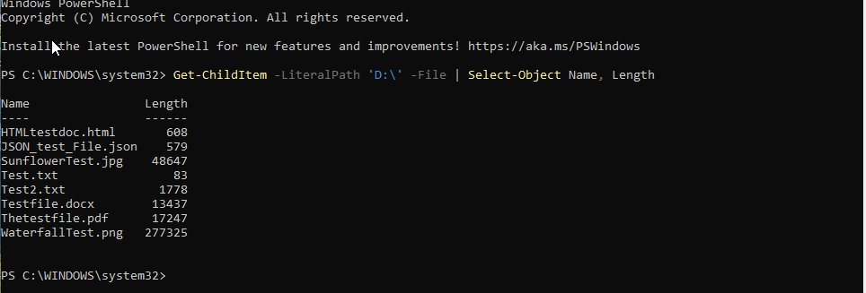

# Week 6 Known-File Manifest

**Source:** Dedicated unencrypted `NTFS_BASELINE (D:)` volume in the controlled
VirtualBox guest.  
**Purpose:** Validation set for the MFT file-listing feature.  
**Image:** `NTFS_Forensic_Baseline_Unencrypted_FilesAdded_RAW.dd`  
**Image SHA-256:** `053D7CF98D07AAAEE265A1B4D027B384C528ABC55F1D59310B9BFDEE2CB76691`

The sizes below are the values displayed in the VirtualBox guest's File
Explorer. They are included as validation context; the primary comparison for
this milestone is the file name and MFT record located by the parser.

| # | File name | Type | Explorer size | MFT record found by parser |
|---|---|---|---:|---:|
| 1 | `HTMLtestdoc.html` | HTML document | 1 KB | 55 |
| 2 | `JSON_test_File.json` | JSON document | 1 KB | 56 |
| 3 | `SunflowerTest.jpg` | JPEG image | 48 KB | 42 |
| 4 | `Test.txt` | Text document | 1 KB | 38 |
| 5 | `Test2.txt` | Text document | 2 KB | 39 |
| 6 | `Testfile.docx` | Word document | 14 KB | 41 |
| 7 | `Thetestfile.pdf` | PDF document | 17 KB | 43 |
| 8 | `WaterfallTest.png` | PNG image | 271 KB | 44 |

## Validation result

The read-only parser scanned the first 64 MFT records in the full-disk RAW
image and located all eight file names listed above. The parser output and the
VirtualBox File Explorer screenshot are retained in the Week 6 evidence folder.

The parser also displayed two additional `$...txt` names. They are not listed
here because they were not identified as part of the controlled visible
validation set.

## Exact-size comparison completed October 18

Lucas supplied a guest-VM PowerShell listing of full filenames and exact
`Length` values. Jeff compared it with the unnamed `$DATA` logical sizes
already recorded in [attribute validation](week7_attribute_parser_validation.md).
All eight names and byte sizes match; this closes the exact-size follow-up.

| File | Guest VM bytes | Parser logical bytes | Result |
|---|---:|---:|---|
| `HTMLtestdoc.html` | 608 | 608 | Match |
| `JSON_test_File.json` | 579 | 579 | Match |
| `SunflowerTest.jpg` | 48,647 | 48,647 | Match |
| `Test.txt` | 83 | 83 | Match |
| `Test2.txt` | 1,778 | 1,778 | Match |
| `Testfile.docx` | 13,437 | 13,437 | Match |
| `Thetestfile.pdf` | 17,247 | 17,247 | Match |
| `WaterfallTest.png` | 277,325 | 277,325 | Match |

This independently checks names and logical sizes, not file-content hashes,
timestamps, or complete image identity. Payload recovery/hash validation
remains separate work.
