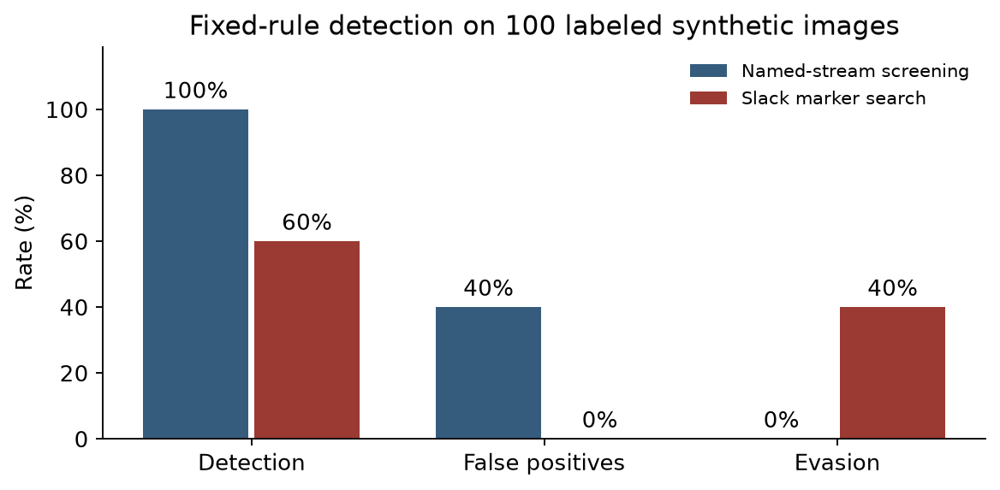

# Detection and Evasion Measurement — November 25, 2026

Completed a separate, reproducible screening experiment to address the final
report's detection-evasion measurement gap. Recovery hash comparisons and
this experiment answer different questions.

## Measured results

| Metric | Named-stream screening | Slack marker search |
|---|---:|---:|
| Cases | 50 | 50 |
| Hidden positives / negatives | 25 / 25 | 25 / 25 |
| TP / FN / FP / TN | 25 / 0 / 10 / 15 | 15 / 10 / 0 / 25 |
| Accuracy | 80% | 80% |
| Detection rate | 100% | 60% |
| False-positive rate | 40% | 0% |
| Evasion rate | 0% | 40% |



The ADS rule flags any named DATA attribute in a selected record. All 25
intentionally hidden streams were flagged. Ten legitimate named-stream
controls were also flagged; 15 ordinary files were not. Those ten flags are
false positives relative to **intentional concealment**, not incorrect stream
enumeration. A named stream's presence alone does not establish intent.

The slack rule searches the entire calculated tail for the known 25-byte
`TEAM3_SLACK_TEST_20261008` marker. All 15 plaintext placements were found.
Ten markers reversibly transformed byte by byte with XOR `0x5A` were missed.
Fifteen random-tail controls and ten controls with the marker only in ordinary
logical content were correctly rejected. This demonstrates a literal
signature's limitation, not resistance to a capable examiner or encryption.

Detection = TP / (TP + FN); FPR = FP / (FP + TN); evasion = FN / (TP + FN);
accuracy = (TP + TN) / all cases. Values are percentages. The two rules are
reported separately rather than pooled into a general discovery score.

## Method and scope

- Construction labels are assigned before screening. The detector receives
  only the image and selected record, with the slack signature fixed in advance.
  It receives no label, expected payload hash, planted offset, or ADS name.
- Seed: `4811125`. Each synthetic image is 32,768 bytes and shares the portable
  fixture's layout. These are NTFS-shaped test inputs, not mountable Windows
  volumes or a representative population of user files.
- Named-stream controls use `Zone.Identifier` or `SummaryInformation`.
  Scenario proportions are deliberately chosen challenges, not real prevalence.
- Errors abort the campaign instead of being scored as true negatives.
- All 100 source image hashes were unchanged after screening.
- On the preserved Windows image, both known positives were flagged: record
  58's `CapstoneEvidence` stream and record 41's slack marker at relative offset
  zero. The full image SHA-256 matched the recorded working hash before and
  after. These two checks do not establish real-volume false-positive rates.
- Python 3.15.0 executed the experiment. The expanded suite passed **73 tests
  in 9.567 seconds**. The November 24 tagged release's 68-test result is historical
  and remains unchanged.

The missing experiment is now supplied within this defined scope. General
unknown-payload discovery, statistical steganalysis, independent-volume
performance, and filesystem copy/write survival remain outside these results.

## Reproduction and evidence

From the repository root on the report branch, choose a new destination:

```powershell
py tests/run_detection_campaign.py detection_campaign_new
```

Optional Windows positive checks, requiring the separately retained 8 GB image:

```powershell
py tests/run_detection_campaign.py detection_campaign_lab --lab-image "NTFS_Forensic_Baseline_ADS_Slack_Working_RAW.dd"
```

No third-party Python dependencies are needed. Existing output directories
are refused. Generated images are excluded from Git; the included generator
recreates them. Compare their hashes against `fixture_manifest.json`.

- `results.csv`: all 100 construction labels, predictions and outcomes.
- `summary.json`: counts, rates, source-preservation and Windows checks.
- `fixture_manifest.json`: scenario, target record and SHA-256 for each image.
- `regression.txt`: complete November 25 expanded test output.
- `detection.png`: plot generated from the saved summary by
  `reports/final_report/plot_results.py` (optional Matplotlib).

The summary's UTC timestamp falls on November 26; the run occurred on
November 25 in America/New_York. The code release tag `v1.0-final` is unchanged.
