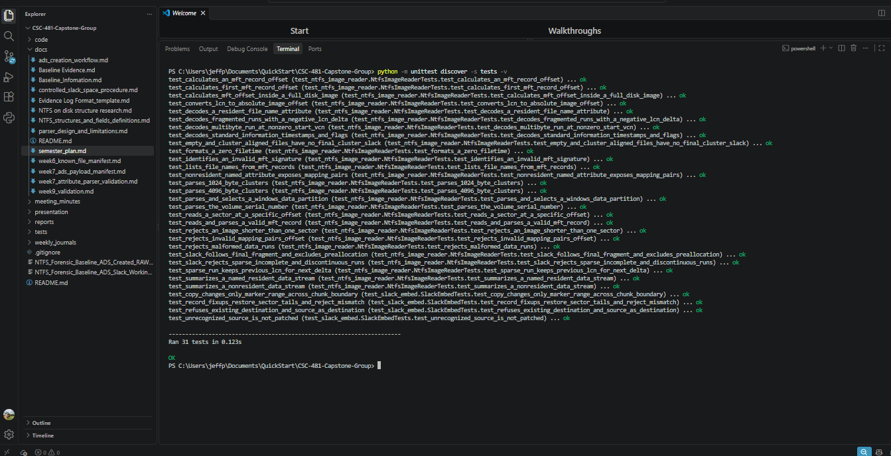
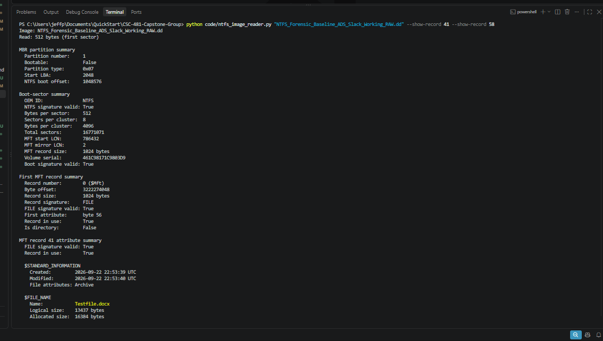
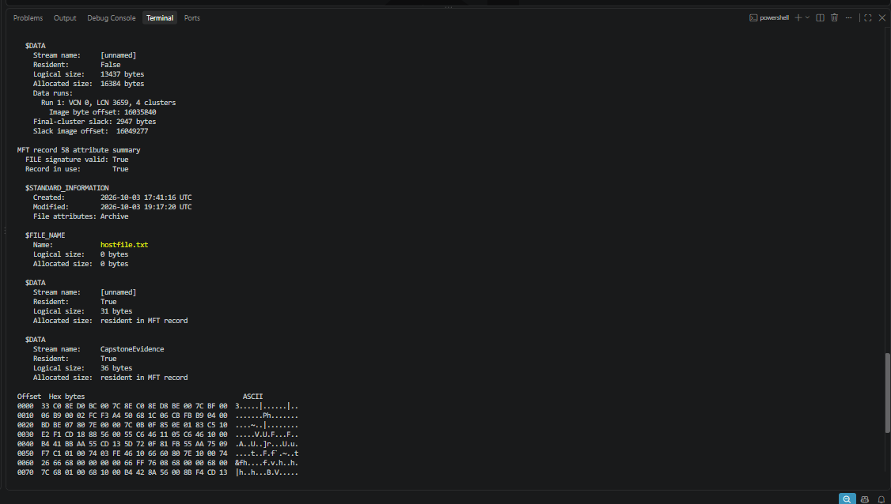

# Week 9 Evidence

- `w9_automated_tests.png`: October 15 terminal run showing all 31 tests
  passing, no skips or failures, and `OK`. Runtime shown is 0.123 seconds.
- `w9_parser_record41.png`: command, image geometry, and record 41 identifying
  Testfile.docx with logical size 13,437 and allocated size 16,384 bytes.
- `w9_parser_slack_ads.png`: continuation showing LCN 3,659/four clusters,
  2,947-byte slack at 16,049,277, then hostfile.txt record 58 with unnamed
  resident 31 bytes and named CapstoneEvidence resident 36 bytes.
- `w9_vm_exact_file_sizes.png`: Lucas's guest-VM PowerShell listing received
  October 18. All eight full filenames and byte sizes match the parser's
  previously recorded unnamed DATA logical sizes.

The original manual ADS workflow and evidence are retained.
See [validation notes](../../../docs/week9_validation.md)
and the [weekly report](../../weekly_report_09.md).
