# Midterm Team Progress Report

**Project:** NTFS Filesystem Steganography and Forensic MFT Parser  
**Course and team:** CSC-481 Capstone, Team 3  
**Members:** Lucas Curtis (team leader) and Jeff Perez (parser lead)  
**Coverage:** August 31 through October 11, 2026; technical results captured through October 8 and documentation/team review through October 11  
**Status:** Prepared for final team-leader review and commit; GitHub upload and course submission remain pending.

## 1. Project objective and current progress

The project demonstrates two ways data can be hidden in an NTFS filesystem:
Alternate Data Streams (ADS) and unused space at the end of a file's final
allocated cluster (file slack). The team is building a Python raw-sector
parser and, later, a read-only extractor to identify and recover documented
test payloads from controlled `.dd` disk images.

Since the beginning of the semester, the team has established the repository
and research references, created an unencrypted VirtualBox NTFS lab image,
validated the boot-sector parser against Windows, listed eight known files,
implemented three major MFT attribute types, and identified a controlled ADS.
During Week 8, Jeff added data-run decoding, calculated file slack, and embedded
a known marker into a new working-image copy. Independent read-back confirmed
the slack marker's length and hash.

These results demonstrate working metadata parsing and controlled hiding.
They do not yet demonstrate a completed general-purpose forensic extractor or
hash-validated ADS recovery. Those are later milestones in the
[semester project plan](../docs/semester_plan.md).

All image experiments use the dedicated lab or the early controlled practice
image. The parser reads images without modifying them. The separate slack
embedding tool writes only to a newly created project-image copy, not to the
source image or a physical disk. Large disk images are kept outside Git
tracking; code, manifests, reports, and screenshots are the repository artifacts.

## 2. Milestones achieved and remaining

| Milestone and planned dates | Progress through October 11 | Evidence and qualification |
|---|---|---|
| 1. Setup and technical design, Aug. 31-Sept. 6 | Research, repository organization, evidence template, field references, and initial parser/test workflow established. | Week 3 research and reader evidence. Design decisions are documented across the references, code, and reports rather than a separate completed design document. |
| 2. Lab image and boot-sector parser, Sept. 7-20 | Achieved. Unencrypted baseline exported and hash-verified; partition-aware boot parser validated against Windows. | Week 5 manual reads, parser output, and `fsutil` comparison. |
| 3. Initial MFT parser and file listing, Sept. 21-27 | File-listing target achieved: all eight known names located. | Week 6 manifest and VM/parser screenshots. Explorer sizes are rounded; exact content-size/hash validation is not complete for all files. |
| 4. Attributes and controlled hiding, Sept. 28-Oct. 11 | Technical demonstrations completed: attributes, controlled ADS, data runs, and controlled slack marker. ADS creation steps supplied October 11 and documented. | Week 7 ADS manifest, documented manual workflow, and Week 8 slack manifest. A standalone reusable ADS creation tool is not supplied. |
| 5. Midterm integration, Oct. 12-18 | Started ahead of the planned interval with this cumulative draft and linked evidence. | Team review, documentation closeout, and submission remain. |
| 6. Recovery/extractor, Oct. 19-Nov. 8 | Not complete. Data-location support provides a foundation. | Known-offset slack read-back is not generalized recovery; extracted ADS hash validation remains future work. |
| 7. Full test campaign, Nov. 9-22 | Future milestone; incremental regression testing is already underway. | Current suite has 31 passing tests. |
| 8. Final report/demo/presentation, Nov. 23-29 | Future milestone. | Final packaging and presentation remain scheduled. |

## 3. Completed subtasks and ownership

| Period | Lucas Curtis | Jeff Perez |
|---|---|---|
| Aug. 31-Sept. 6 | Researched NTFS structures, created definitions and an evidence-log template, and reviewed the initial parser work. | Studied NTFS fundamentals, implemented read-only sector/boot parsing and hex output, and added three tests. |
| Sept. 7-13 | Created the dedicated VirtualBox baseline, exported a RAW disk image, and recorded configuration and hash evidence. | Located and validated MFT record 0; reported header fields and expanded the suite to six tests. |
| Sept. 14-20 | Disabled BitLocker, verified decryption, exported the replacement baseline, and supplied integrity and Windows comparison evidence. | Added MBR selection and partition-relative reads, validated absolute MFT offsets, checked the replacement hash, and reached ten tests. |
| Sept. 21-27 | Created eight known files, exported the files-added image, and supplied VM file-list and image-hash screenshots. | Implemented `$FILE_NAME` decoding and MFT file listing; located all eight names and reached twelve tests. |
| Sept. 28-Oct. 4 | Manually created the controlled `CapstoneEvidence` ADS; supplied stream names, lengths, marker/hash evidence, and the exported image. | Implemented `$STANDARD_INFORMATION`, `$FILE_NAME`, and `$DATA` summaries, selected-record inspection, and yellow filename output; validated the ADS image and reached seventeen tests. |
| Oct. 5-11 | Participated in Monday planning and Friday review; supplied written ADS creation steps, received October 11. | Implemented data-run decoding, final-cluster slack calculation, and protected copy-based embedding; verified the marker and image integrity, documented the procedure, and reached thirty-one tests. Reviewed and corrected the supplied ADS instructions against source evidence; participated in Friday review. |

Both members have contributed technical work and documentation. Their Week 8
journals record the completed work: [Jeff's journal](../weekly_journals/2026-10-11_jeff_perez.md)
and [Lucas's journal](../weekly_journals/2026-10-11_lucas_curtis.md).
The cumulative midterm report and linked evidence form the team's submission
package, subject to final review and upload.

## 4. Detailed tests and screenshot evidence

### 4.1 Initial boot-sector parsing and first MFT record

**Input:** Controlled practice image `7-ntfs-undel.dd`, 6,160,384 bytes.  
**Method:** Read the first 512 bytes, decode boot fields, then calculate the
MFT location and read its first 1,024-byte record.  
**Expected:** Valid NTFS and boot signatures; correct cluster geometry;
record 0 at the calculated location with a `FILE` header.  
**Observed:** 512 bytes per sector, two sectors per cluster, 1,024 bytes per
cluster, and MFT start LCN 2,005. The volume-relative MFT offset was
`2005 × 1024 = 2,053,120`. Record 0 had a valid `FILE` signature, first
attribute at byte 56, in-use status true, and directory status false. Passed.

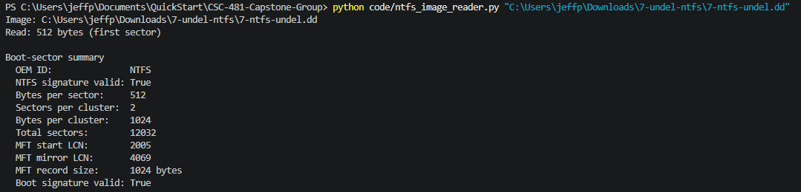

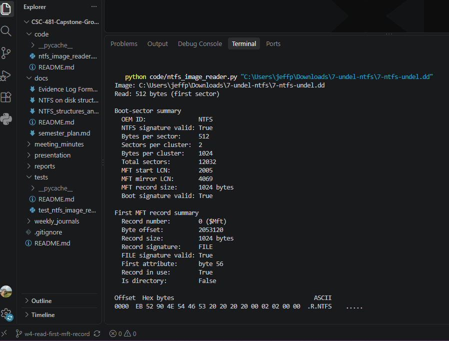

Lucas's research and evidence template supported field interpretation and
consistent result recording. The Week 3 report also records a successful
non-NTFS warning check; no separate screenshot of that check is included here.

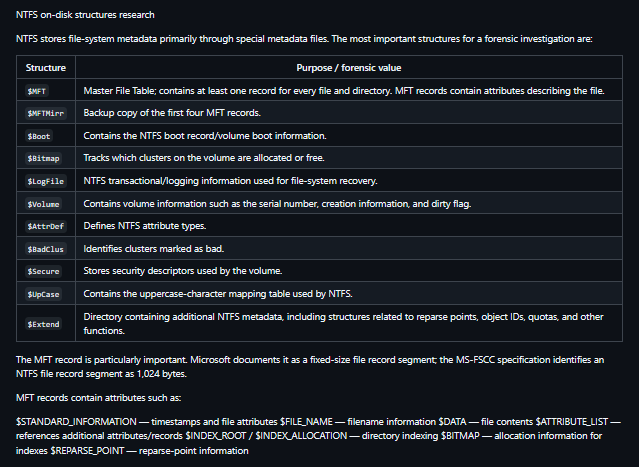

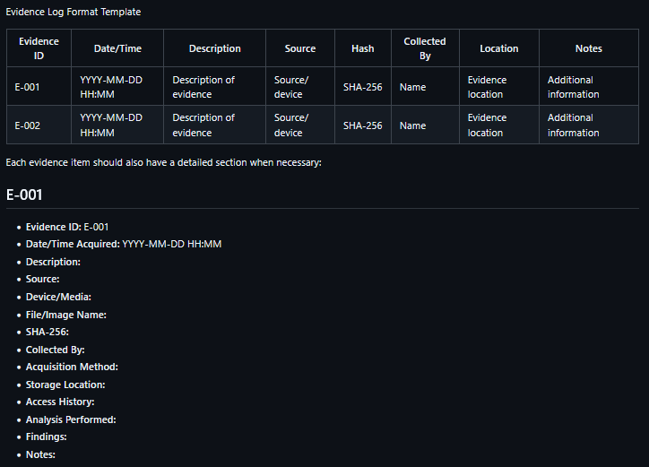

### 4.2 Full-disk baseline, partition offsets, and trusted-tool comparison

**Input:** `NTFS_Forensic_Baseline_Unencrypted_RAW.dd`.  
**Method:** Parse the MBR, read the selected partition's boot sector manually
with PowerShell, run the Python reader, and compare fields with Windows
`fsutil fsinfo ntfsinfo D:` inside the VM. Independently hash the downloaded
image and compare it with Lucas's supplied value.  
**Expected:** The image contains a readable NTFS volume; manual and automatic
values agree; Windows reports matching geometry and MFT locations; image
hashes match.  
**Observed:** All comparisons passed.

| Field | Validated value |
|---|---|
| MBR partition type / start LBA | `0x07` / 2,048 |
| NTFS partition byte offset | 1,048,576 |
| Bytes per sector / cluster | 512 / 4,096 |
| MFT start / mirror LCN | 786,432 / 2 |
| MFT record size | 1,024 bytes |
| Absolute first MFT offset | 3,222,274,048 |
| Volume serial | `461C98171C9803D9` |

The absolute MFT calculation is
`1,048,576 + (786,432 × 4,096) = 3,222,274,048`.
The replacement baseline SHA-256 was:

```text
EFA4CA3DFA0127F7634EE71D59629A565DCEABB93B23A4A135C5B7AB84AE5E91
```

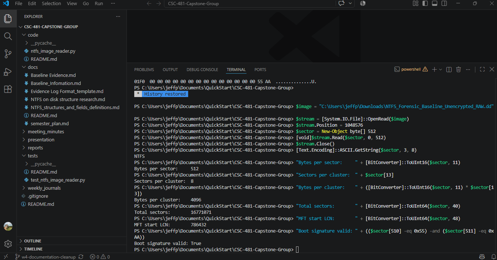

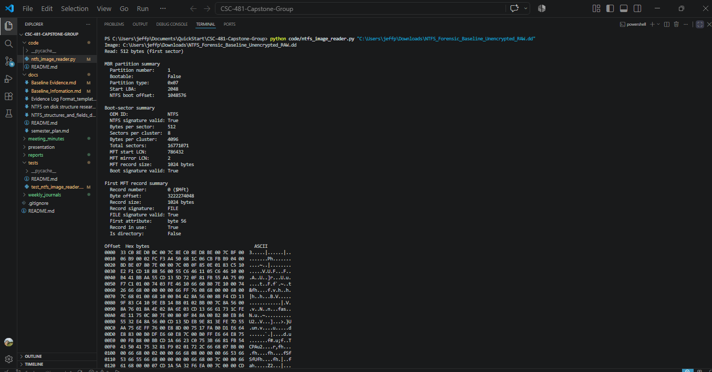

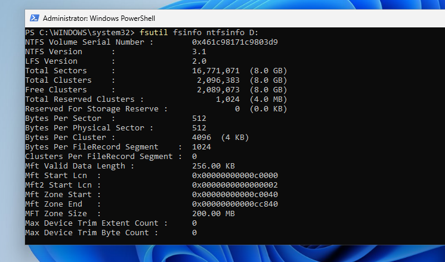

The earlier image's matching hash did not establish that it was usable for
raw NTFS parsing: its target partition was BitLocker-protected. Replacing it
with a decrypted baseline resolved that issue, rather than adding decryption
to the project's scope.

### 4.3 Eight-file MFT listing

**Input:** `NTFS_Forensic_Baseline_Unencrypted_FilesAdded_RAW.dd`.  
**Method:** Scan the first 64 MFT records with `--list-files 64` and compare
decoded filenames with Lucas's VM screenshot and the
[known-file manifest](../docs/week6_known_file_manifest.md).  
**Expected:** All eight controlled filenames appear.  
**Observed:** Eight of eight names located; passed.

| Known file | MFT record |
|---|---:|
| `Test.txt` | 38 |
| `Test2.txt` | 39 |
| `Testfile.docx` | 41 |
| `SunflowerTest.jpg` | 42 |
| `Thetestfile.pdf` | 43 |
| `WaterfallTest.png` | 44 |
| `HTMLtestdoc.html` | 55 |
| `JSON_test_File.json` | 56 |

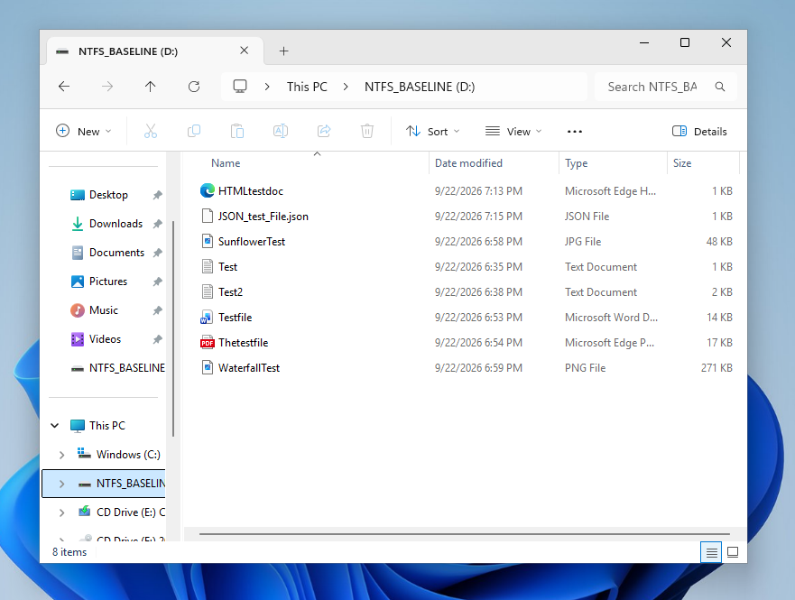

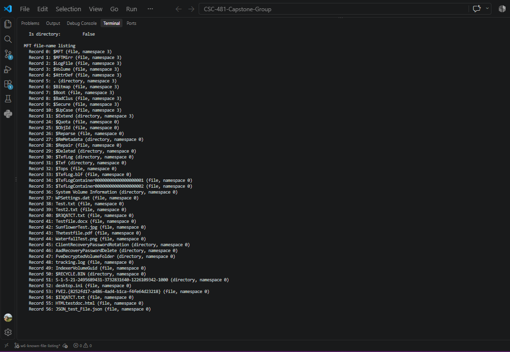

Explorer's displayed KB sizes are rounded reference values, not exact byte
measurements. Other NTFS/system filenames in the listing are not counted as
controlled validation files. Lucas supplied the image-hash screenshot; this
report does not claim an independently confirmed download hash for that version.

### 4.4 Attribute summaries and controlled ADS

**Method:** Inspect selected known-file records with `--show-record`; decode
timestamps and flags from `$STANDARD_INFORMATION`, filename information from
`$FILE_NAME`, and stream names/sizes/residency from `$DATA`. Then independently
hash the ADS image and inspect its host record 58.  
**Expected:** Ordinary and named streams are distinguished; resident and
nonresident states are reported; the controlled ADS agrees with VM evidence.

**Observed:** `Test.txt` had 83 bytes of resident unnamed data. Larger files
had nonresident data, including `Testfile.docx` with 13,437 logical bytes and
16,384 allocated bytes. Existing `Zone.Identifier` streams were identified
but not treated as the team's hidden payload. In the ADS image, record 58
identified `hostfile.txt`, with 31 bytes of unnamed resident data and a
36-byte resident stream named `CapstoneEvidence`. These lengths and the stream
name matched Lucas's guest-VM output. Passed for metadata identification.

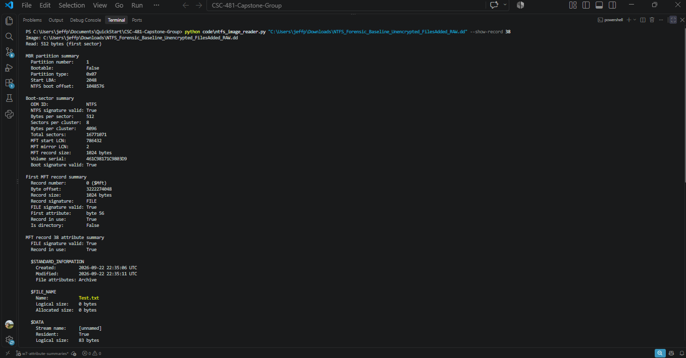

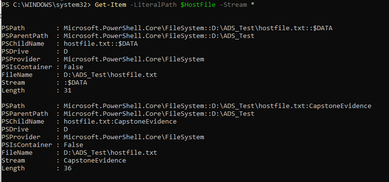

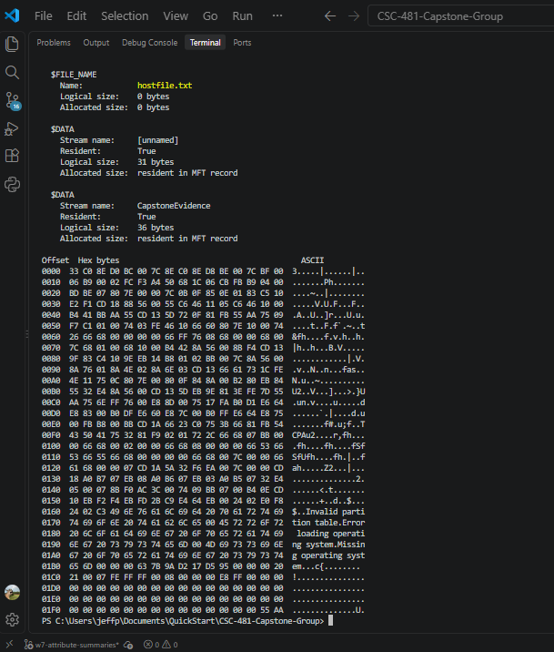

The ADS marker is `CAPSTONE_ADS_TEST_20261001_Team3_001`. Lucas recorded its
payload SHA-256 as:

```text
E3CB29B996899849E804A8FD7DB33F7CCECBCB2569005353BD082D320D0D997E
```

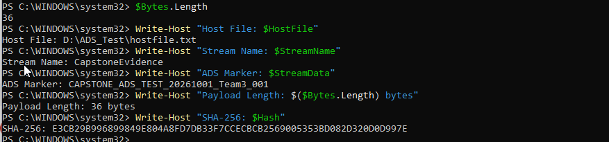

The downloaded ADS image's SHA-256 independently matched Lucas's source
evidence. The [ADS manifest](../docs/week7_ads_payload_manifest.md) records
the details. Lucas supplied his [manual creation steps](../docs/ads_creation_workflow.md)
on October 11. Review corrected marker capitalization, an unsupported hashing
parameter, and the earlier hash transcription against the screenshot and
exact ASCII marker. Extracting the ADS and comparing the recovered payload hash has
not yet been completed.

### 4.5 Data runs, slack calculation, and protected embedding

**Input:** Verified ADS source image; ordinary unnamed nonresident data in
`Testfile.docx`, MFT record 41.  
**Method:** Decode its run, convert the LCN to an absolute image offset,
calculate the final-cluster tail, and run the dedicated embedding tool to
create a new working image containing a 25-byte marker.  
**Expected:** Locate slack after the logical file end; preserve the source;
modify only the intended marker range in the copy.

**Observed:** The run began at LCN 3,659 and covered four clusters. The file
started at image byte 16,035,840. Its final cluster was LCN 3,662, with 2,947
slack bytes beginning at absolute byte 16,049,277. The tool wrote
`TEAM3_SLACK_TEST_20261008` there using UTF-8 without a BOM or newline.
Full-image comparison verified that every byte outside the 25-byte payload
range matched the source. The original source hash remained unchanged. Passed.

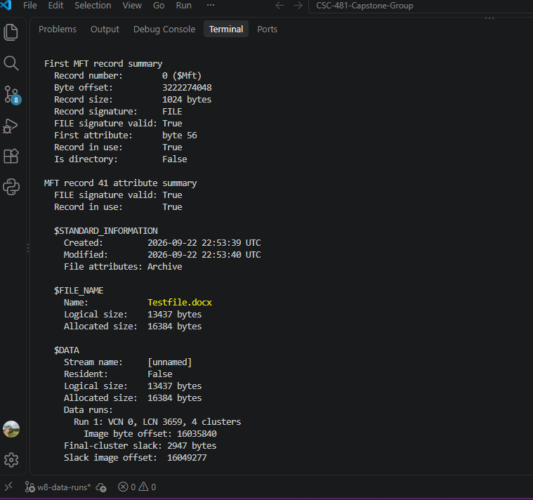

The parser still reported the original file metadata and the controlled ADS
on the working copy. The detailed
[slack procedure](../docs/controlled_slack_space_procedure.md) and
[generated manifest](evidence/week8/w8_slack_payload_manifest.json) document
the location, hashes, and protection checks.

### 4.6 Independent slack-marker read-back

**Method:** Separately open the working image read-only in PowerShell, seek
to byte 16,049,277, read exactly 25 bytes, decode the marker, and calculate
SHA-256 over those bytes.  
**Expected:** The marker, byte length, and hash match the embedding manifest.  
**Observed:** All three matched; passed.

```text
Marker: TEAM3_SLACK_TEST_20261008
Length: 25 bytes
SHA-256: 3BF8F582FF237AD7F739D39EDCF54CB35E0E6FDFD75AD47CA55F3598629390F2
```

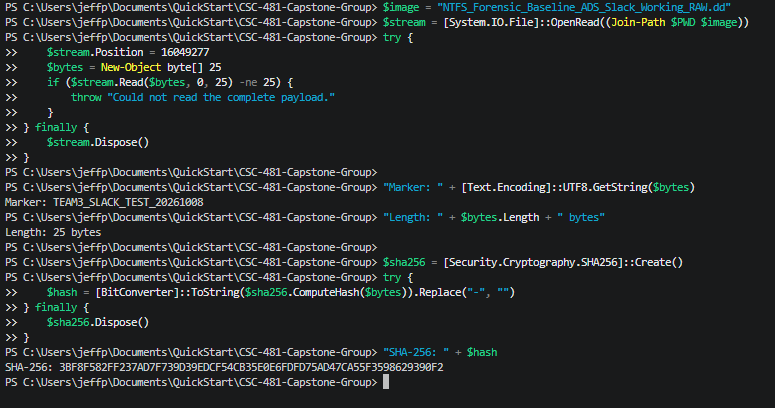

This verifies a documented location. It does not demonstrate automatic
discovery or a completed recovery command.

### 4.7 Automated regression and negative tests

The team runs `python -m unittest discover -s tests -v`. Synthetic records
provide known expected values and malformed cases; real-image tests above
check the lab workflow separately.

| Reporting period | Passing tests | Features covered as the suite expanded |
|---|---:|---|
| Week 3 | 3 | 1,024/4,096-byte cluster layouts; incomplete-sector rejection. |
| Week 4 | 6 | MFT offset/header parsing and invalid `FILE` signatures. |
| Week 5 | 10 | MBR selection, offset reads, full-disk MFT location, volume serial. |
| Week 6 | 12 | Resident filename decoding and MFT listing. |
| Week 7 | 17 | Timestamps/flags, zero FILETIME, selected-record offsets, resident named streams, nonresident summaries. |
| Week 8 | 31 | Data-run decoding, slack boundaries, embedding protection, and embedding-tool record fixups. |

Week 8 coverage includes signed negative LCN changes, multi-byte mapping
pairs, nonzero starting VCNs, sparse runs, malformed runs and invalid offsets.
Slack tests cover fragmented files, extra preallocation, empty/aligned files,
and rejection of incomplete, discontinuous, or sparse coverage. Embedding
tests check marker-only changes across a copy-chunk boundary, refusal to
overwrite an existing destination or use the source as destination, refusal
of an unrecognized source, and MFT sector-tail fixup validation/restoration.
All 31 tests passed in the captured run. This is coverage of implemented
behavior, not proof of compatibility with every NTFS image.

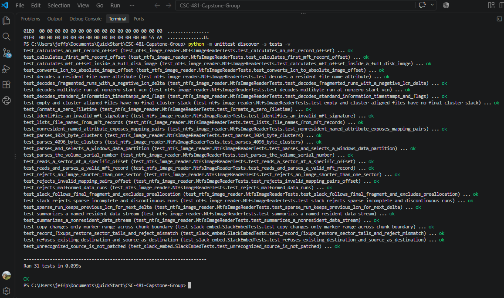

Historical test screenshots are retained with the
[Week 3](weekly_report_03.md), [Week 4](weekly_report_04.md),
[Week 5](weekly_report_05.md), [Week 6](weekly_report_06.md), and
[Week 7](weekly_report_07.md) reports.

## 5. Lessons learned across the project

- Storage geometry must come from the image. The practice image used
  1,024-byte clusters; the lab volume uses 4,096-byte clusters. A parser
  cannot assume the same cluster layout for every input.
- Disk, volume, and cluster offsets are different coordinate systems.
  Full-disk parsing requires adding the partition offset to volume-relative
  locations. LBA, LCN, and VCN must not be used interchangeably.
- Matching hashes establish matching bytes, not a usable filesystem.
  BitLocker prevented raw NTFS inspection despite a successful transfer check.
- An MFT record is a file's metadata record, not its contents. The `FILE`
  signature identifies the record; individual attributes provide different
  information. `$FILE_NAME` size fields can differ from the current `$DATA`
  size, so content size is checked against the data attribute.
- ADS is an NTFS feature, not automatically evidence of wrongdoing.
  The controlled `CapstoneEvidence` marker must be distinguished from normal
  named streams such as `Zone.Identifier`.
- Lucas learned to create ADS manually through PowerShell, supported by
  reading and tutorials. Recording the host, stream name, length, and hash
  made the demonstration reproducible and reviewable.
- During Week 8, Lucas strengthened his understanding of ADS and the work
  needed to complete his assigned tasks by documenting the manual workflow.
  He reported no problems; both members reported no issues at Friday's review.
- Resident content is inside the MFT record; nonresident content requires
  following data runs. Relative LCN changes can be negative, and fragmented
  files require following the logical end rather than assuming one extent.
- Slack is the unused tail of the final content cluster, not every allocated
  byte beyond logical size. Extra preallocation needs separate treatment.
- Safe experiments preserve source evidence. A verified source, new output
  copy, exact write range, and full byte comparison made the slack test auditable.
- Unit tests, independent Windows output, real-image tests, and screenshots
  complement one another. Readable screenshots must show commands and results,
  including the final test summary.
- Weekly journals, manifests, and evidence capture reduce the effort needed
  to reconstruct cumulative progress and distinguish each member's work.

## 6. Contributions and commit evidence

Lucas's cumulative contribution is the controlled lab and source evidence:
NTFS research, reference documents, baseline acquisition/remediation,
known-file set, manual ADS creation, image exports/hashes, meeting records,
individual journals, report updates, and team-leader review/integration.

Jeff's cumulative contribution is the parser and technical validation:
boot-sector and partition handling, MFT records/listing, attribute summaries,
data runs and slack calculations, controlled embedding code, automated tests,
independent checks, screenshots, manifests, journals, and report preparation.

Representative existing commits in the local repository history include:

| Member / repository author | Commit | Recorded contribution |
|---|---|---|
| Lucas / `Lcurtis1Broncos` | `8a7e87d` | Updated baseline evidence. |
| Lucas / `Lcurtis1Broncos` | `d9cbf40` | Revised September 13 journal. |
| Lucas / `Lcurtis1Broncos` | `6187f74` | Updated Week 5 journal. |
| Lucas / `Lcurtis1Broncos` | `6b6bbf4` | Updated meeting minutes. |
| Jeff / `Jeff Perez` | `420edab` | Full-disk NTFS parsing and evidence. |
| Jeff / `Jeff Perez` | `ee584dc` | Windows `fsutil` comparison. |
| Jeff / `Jeff Perez` | `f50ce53` | Known-file MFT listing. |
| Jeff / `Jeff Perez` | `489ec16` | Attribute parsing and controlled ADS validation. |

These are examples, not a full commit inventory or an estimate of relative
effort. Shared reports can be edited by either member; document authorship
does not by itself prove who performed every experiment. Contributions above
are based on the reports and source evidence as well as history.

At this draft's cutoff, Week 8 changes and this midterm draft are local and
uncommitted. Task 1 is not complete for the current submission until the
approved changes are committed, pushed, and reviewed through the team's
GitHub workflow. Each member must maintain genuine, attributable contributions;
this report does not replace the assignment's commit requirement.

## 7. Progress against the plan and adjustments

The technical work is broadly on schedule: the baseline was validated by
September 20, the eight-file listing by September 27, and attributes plus
both controlled hiding demonstrations are available within the September
28-October 11 Milestone 4 interval. Midterm integration is beginning early.
Documentation and submission closeout must still be completed before the
current package is described as finished.

At the Friday, October 9 meeting at 7:30 p.m., both members reviewed their
assignments and completed work and discussed finishing the midterm package.
No issues were reported. GitHub upload and course submission remain separate
steps and are not claimed as completed by that meeting.

| Adjustment or issue | Response and effect |
|---|---|
| Dedicated lab was not ready in the initial setup period. | Continued early development on a controlled practice image; Lucas supplied the dedicated baseline during the following period. |
| Initial baseline contained BitLocker protection. | Lucas disabled protection and exported a new baseline; Jeff verified the replacement. Decryption was not added to project scope. |
| Lab export was a full-disk image, not volume-only. | Added MBR parsing and partition-offset calculations while retaining volume-only support. |
| Original known-file target was ten files. | Revised the project plan to eight files, including HTML and JSON, and validated all eight names. Rounded size evidence remains explicitly qualified. |
| ADS creation was manual rather than a saved reusable tool. | Lucas supplied the written steps October 11; the corrected workflow, screenshots, and manifest are documented. A standalone tool remains a plan-output gap to resolve or explicitly adjust. |
| Recovery is not yet implemented. | Keep metadata identification and known-offset verification separate from extraction claims; implement and hash-validate recovery in Milestone 6. |

No unresolved failure was reported for the completed Week 8 real-image test
or captured automated suite. Known limitations remain: the parser is not a
complete NTFS implementation; generalized fragmented-MFT traversal and
extension-record attribute resolution are not demonstrated. Embedding-tool
fixup support is not proof of equivalent protection in every parser path.
The embedding workflow is deliberately restricted to the verified lab source
and supported ordinary nonresident streams; resident, compressed, sparse,
encrypted, and extension-record embedding is excluded.

## 8. Next steps and submission closeout

1. Lucas reviews his prepared Week 8 journal, the corrected ADS workflow, and
   the cumulative report before committing his documentation contributions.
   Jeff has reviewed the report; final team-leader approval remains.
2. Commit and push the approved Week 8 work and midterm package for team-leader
   review. Confirm the course deadline and submission format before submitting.
3. Complete Milestone 5 validation/limitations and assemble the final midterm
   evidence package during the planned October 12-18 interval.
4. Implement read-only ADS and slack recovery, compare recovered payload
   hashes with the original manifests, and validate data locations for at
   least three files during Milestone 6.
5. Complete the broader test campaign, forensic documentation, final report,
   slides, and live demonstration in the remaining planned intervals.

## Appendix: Current hiding-image integrity records

**ADS source image:** `NTFS_Forensic_Baseline_ADS_Created_RAW.dd`  
Source image SHA-256, independently matched to Lucas's evidence:

```text
2240CF8A1AA9D30231C39C4672DC51157093314950C4930EBBF5D30F5F59D2F5
```

**ADS plus slack working copy:** `NTFS_Forensic_Baseline_ADS_Slack_Working_RAW.dd`  
Working image SHA-256, recorded after controlled embedding:

```text
D54886033D5ED8E6B9BA5C58EF60A414C3F2202BD1A2F6A5A7D407D499BCA5C7
```

The source and working images differ intentionally in the designated 25-byte
slack marker range. They should not have matching whole-image hashes.
The [Week 8 manifest](evidence/week8/w8_slack_payload_manifest.json) records
the original bytes, final range, payload hash, and comparison result.
