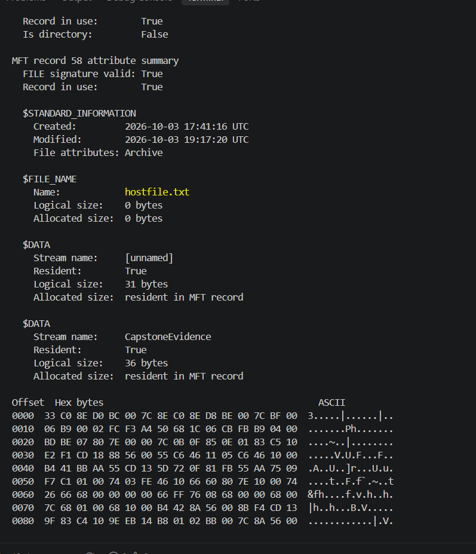
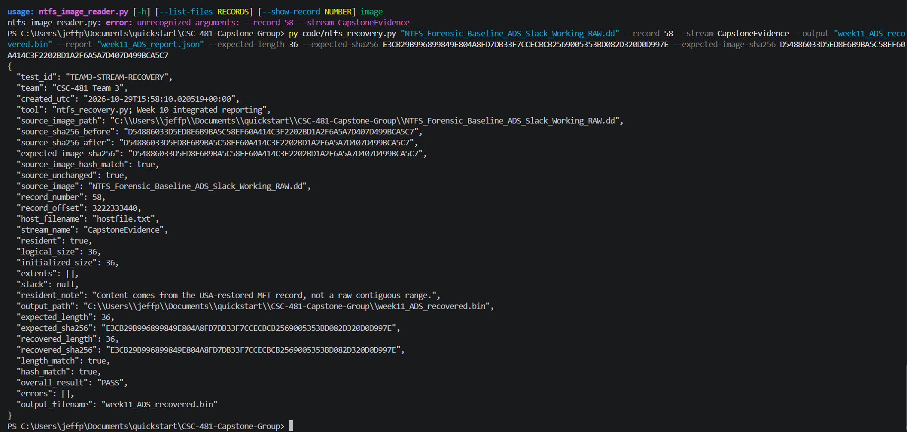
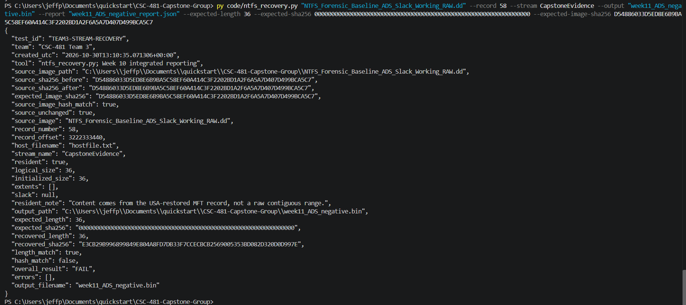
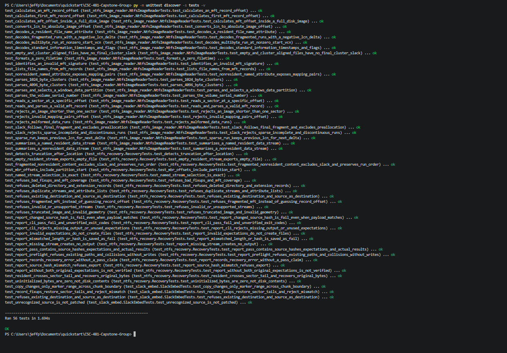

# Week 11 Team Progress Report

**Reporting period:** October 26 - November 1, 2026

**Team:** Lucas Curtis and Jeff Perez

**Status:** Waiting for Lucas input

## Milestones achieved and progress against the plan

Milestone 6, Forensic Recovery and Extractor Implementation, runs October 19
through November 8. The October 26 - November 1 plan assigns ADS recovery
workflow testing to Lucas and parser-based debugging/validation to Jeff.

The Week 10 recovery and automated-report implementation was merged through
PR #19 on October 24. This week used that existing implementation to validate
ADS identification, successful recovery, intentional mismatch handling, and
source preservation. It does not claim the existing code or the 56 tests were
newly implemented this week.

**Achieved this week:** Jeff completed a fresh real-image ADS recovery with
matching original length/hash, a controlled incorrect-expectation test that
correctly reported FAIL, and a passing regression run. No parser/recovery
defect requiring a code change was identified in these runs.

**Team status:** Jeff's assigned validation is complete. Lucas's independent
workflow result has not yet been provided, so the full team assignment and
Milestone 6 are not marked complete. Slack recovery remains scheduled for
November 2 - 8. No schedule adjustment has been confirmed.

## Completed subtasks and contributions

| Member | Work confirmed during this reporting period |
|---|---|
| Jeff | Inspected record 58 and distinguished its 31-byte unnamed stream from the 36-byte CapstoneEvidence ADS. |
| Jeff | Ran the October 29 integrated ADS recovery and checked expected/actual payload values and source before/after hashes. |
| Jeff | Ran the October 30 wrong-expected-hash test and verified rejection without changing the image or payload. |
| Jeff | Ran all 56 automated tests October 30; captured the passing result and supplied recovery screenshots and JSON reports. |
| Jeff and Lucas | Completed both meetings October 26 and October 30, starting at 7:30 p.m. Exchanged work and status; no issues were reported. |
| Lucas | |

Lucas's earlier workflow/template remains the basis for this week's tests;
it is not counted again as a newly authored Week 11 document. Jeff's runs
are not attributed to Lucas.

### Lucas's workflow test results

**Test date:**

**Work completed:**

**Recovery result and evidence:**

**Lessons learned:**

**Problems encountered:**

## Detailed tests and decisive screenshots

Key screenshots are embedded directly below, rather than supplied as links
alone, following the professor's October 28 feedback. JSON reports are
additional reproducible evidence, not substitutes for the screenshots.

### Test 1: Identify the intended ADS — October 28

**Input:** `NTFS_Forensic_Baseline_ADS_Slack_Working_RAW.dd`, MFT record 58.

**Method:** Inspect the parser output:

```powershell
py code/ntfs_image_reader.py "NTFS_Forensic_Baseline_ADS_Slack_Working_RAW.dd" --show-record 58
```

**Expected:** `hostfile.txt`, with an unnamed resident DATA stream of 31 bytes
and a named resident CapstoneEvidence DATA stream of 36 bytes.

**Observed:** Both streams and sizes were displayed as expected. This is
metadata identification, not recovered-content verification. The FILE_NAME
size shown in the screenshot is not used as the stream's current content size.



*Figure 1. The named DATA attribute identifies the stream to select with
`--stream CapstoneEvidence`; omitting that option selects the unnamed stream.*

### Test 2: Recover and verify the ADS — October 29

**Method:** Select record 58 and CapstoneEvidence, use new output/report
filenames, and supply the original payload length/hash and recorded image
hash. The command hashes the complete image before and after export.

```powershell
py code/ntfs_recovery.py "NTFS_Forensic_Baseline_ADS_Slack_Working_RAW.dd" --record 58 --stream CapstoneEvidence --output "week11_ADS_recovered.bin" --report "week11_ADS_report.json" --expected-length 36 --expected-sha256 E3CB29B996899849E804A8FD7DB33F7CCECBCB2569005353BD082D320D0D997E --expected-image-sha256 D54886033D5ED8E6B9BA5C58EF60A414C3F2202BD1A2F6A5A7D407D499BCA5C7
```

**Expected:** Recover 36 bytes, match the original payload SHA-256, and leave
the known working image unchanged.

**Observed:** `length_match`, `hash_match`, `source_image_hash_match`, and
`source_unchanged` were all true; overall result PASS; no operational errors.



*Figure 2. `hash_match` verifies the recovered ADS against the original payload
hash. `source_unchanged` compares the full image before/after hashes. The earlier
argument error at the top came from using recovery options with the metadata
reader; rerunning with `ntfs_recovery.py` resolved the command mix-up.*

Machine-readable result: [October 29 recovery report](evidence/week11/w11_ads_recovery_report.json).

### Test 3: Reject an incorrect expected payload hash — October 30

**Method:** Repeat recovery to distinct new output/report paths, keeping the
same source image and expected length, but deliberately supply 64 zeros as
the expected payload SHA-256. Do not modify the image or embedded payload.

```powershell
py code/ntfs_recovery.py "NTFS_Forensic_Baseline_ADS_Slack_Working_RAW.dd" --record 58 --stream CapstoneEvidence --output "week11_ADS_negative.bin" --report "week11_ADS_negative_report.json" --expected-length 36 --expected-sha256 0000000000000000000000000000000000000000000000000000000000000000 --expected-image-sha256 D54886033D5ED8E6B9BA5C58EF60A414C3F2202BD1A2F6A5A7D407D499BCA5C7
```

**Expected:** Matching 36-byte length, false payload hash match, unchanged
source image, and overall verification FAIL. This negative test passes when
the tool rejects the deliberately incorrect expectation.

**Observed:** Exactly that behavior. The recovered actual hash remained the
original payload hash. `errors: []` indicates no operational recovery error;
it does not override the verification failure. The screenshot does not record
the shell exit code, so this run does not separately establish that value.



*Figure 3. `length_match: true` alongside `hash_match: false` demonstrates why
size alone cannot verify content. The FAIL result is expected, not a defect.*

Machine-readable result: [October 30 negative-test report](evidence/week11/w11_ads_negative_report.json).

### Test 4: Regression suite — October 30

**Method:** Run the existing parser, embedding, recovery, and reporting tests:

```powershell
py -m unittest discover -s tests -v
```

**Expected:** All 56 existing tests pass, including malformed-input refusal,
resident sector-tail restoration, nonresident run order, overwrite prevention,
report comparisons, and CLI verification behavior.

**Observed:** **56 tests passed in 1.694 seconds**, no failures or skips.



*Figure 4. This week's fresh regression run passed. These bounded test cases
do not establish support for all possible NTFS layouts.*

### Expected and observed values

| Check | October 29 positive test | October 30 negative test |
|---|---|---|
| Expected length / actual length | 36 / 36 bytes | 36 / 36 bytes |
| Expected payload SHA-256 | Original manifest hash | Deliberately incorrect: 64 zeros |
| Actual payload SHA-256 | Original manifest hash | Same original manifest hash |
| Payload hash comparison | true | false |
| Known source-image hash match | true | true |
| Source unchanged before/after | true | true |
| Overall verification | PASS | FAIL, as expected |

Original payload SHA-256:
`E3CB29B996899849E804A8FD7DB33F7CCECBCB2569005353BD082D320D0D997E`.

Both runs recorded this source hash before and after:
`D54886033D5ED8E6B9BA5C58EF60A414C3F2202BD1A2F6A5A7D407D499BCA5C7`.

## Lessons learned and issues

- Identifying an ADS in metadata is separate from recovering and verifying it.
- The stream name matters: record 58 has both ordinary content and a named ADS.
- Expected values must come from the original manifest, not the recovered output.
- Payload verification and source preservation are separate hash checks.
- A mismatched hash shows different bytes, not the cause; it is not proof of
  tampering by itself. An intentionally wrong expectation must produce FAIL.

Jeff reported no outstanding issues with his portion. The observed command
mix-up was resolved by selecting the recovery utility; no code fix was needed.

## Submission status and remaining team entries

- Jeff's validation, journal, reports, and embedded screenshot evidence are
  finalized for publication. No code change was required by these results.
- Lucas's unconfirmed contribution/results fields and journal sections are
  intentionally blank for him to complete; no workflow run by him is claimed.
- Both meetings are complete, with their 7:30 p.m. start times and no-issue
  status recorded in the single weekly minutes document.
- Publish Jeff's completed portion for review. The team leader remains
  responsible for the course submission; publishing on GitHub is not proof
  of a submission to the course site.

The eight baseline files' independent original hashes remain a broader
Milestone 6 validation gap, not a claim closed by these ADS tests. Next week's
planned work is slack-space recovery and validation, November 2 - 8.

## Team records

- [Jeff's journal](../weekly_journals/2026-11-01_jeff_perez.md)
- [Lucas's journal: blank sections for his entry](../weekly_journals/2026-11-01_lucas_curtis.md)
- [Week 11 meeting minutes: October 26 and 30](../meeting_minutes/2026-10-26.md)
- [Evidence index](evidence/week11/README.md)
