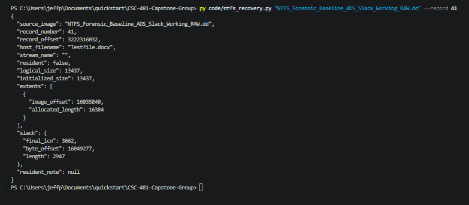
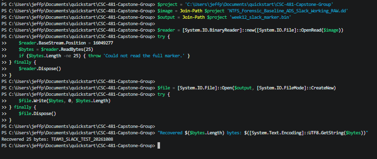
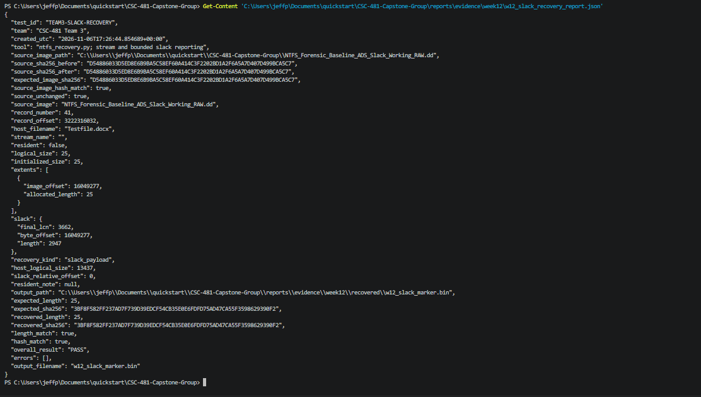
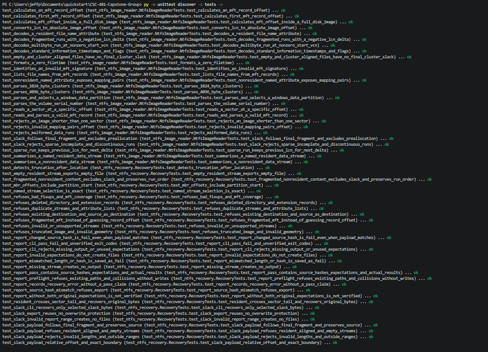
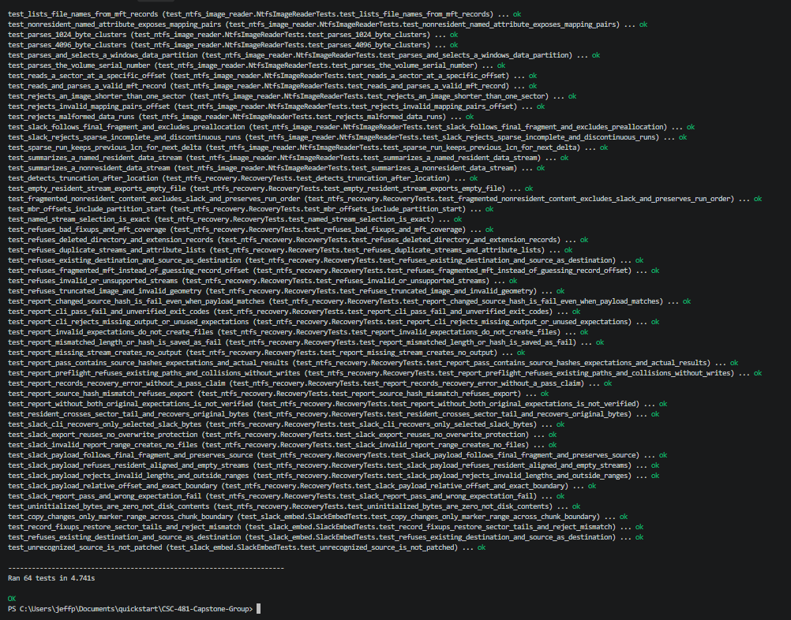

# Week 12 Team Progress Report

**Reporting period:** November 2 - November 8, 2026

**Team:** Lucas Curtis and Jeff Perez

**Status:** Waiting for Lucas input

## Milestone status and progress against the plan

This is the final scheduled week of Milestone 6, Forensic Recovery and
Extractor Implementation. The weekly plan assigns slack-space workflow
testing to Lucas and slack-range/recovery validation to Jeff.

Completed the known slack-payload recovery path and verified a 25-byte output
against the original manifest. Normal file and ADS recovery remain available.
The current implementation does not perform automatic hidden-payload discovery.

The known ADS and slack payloads now have successful recovery/hash evidence.
Independent original hashes for the eight baseline files are still missing,
so their original-content equality remains unverified. Lucas's current-week
workflow result also awaits confirmation. The full milestone is not marked
complete solely because the known slack marker passed.

## Completed subtasks and contributions

| Contribution | Confirmed work |
|---|---|
| Jeff | Inspected record 41 November 3; confirmed the 13,437-byte document, its 2,947-byte slack region, and offset 16,049,277. |
| Jeff | Manually extracted the manifest's first 25 slack bytes November 4, using read-only image access and a new separate output file. |
| Jeff | Reran all 64 tests November 6; all passed in 4.741 seconds. Supplied the test screenshots and display of the integrated PASS report. |
| Recovery implementation, with guided assistance | Added bounded slack selection to the existing recovery/report utility November 6, including host/payload metadata and new range/safety tests. |
| Agent-run verification | Checked the manually recovered file hash, ran 64 regression tests, and performed the new integrated real-image recovery with before/after source hashes November 6. These are distinct from Jeff's personal command runs. |
| Jeff and Lucas | Completed the November 2 planning meeting and November 7 follow-up meeting, both at 7:30 p.m. Shared task status and reviewed completed slack-recovery and validation work. |
| Lucas | Current-week workflow test and results await confirmation. |

## Detailed tests and decisive evidence

### 1. Validate slack location — November 3

**Method:** Inspect record 41 with the recovery utility, without output export.
**Expected:** Testfile.docx has 13,437 logical bytes and a single 16,384-byte
extent starting at 16,035,840. Slack begins at 16,049,277 and spans 2,947 bytes.
**Observed:** Those values matched the original manifest.

*Figure 1. For this contiguous extent, 16,035,840 + 13,437 = 16,049,277.
The general recovery code maps the final logical cluster through the data runs;
it does not assume every file is contiguous.*

### 2. Manually recover the marker — November 4

**Method:** Open the controlled working image read-only, seek to the manifest
offset, read exactly 25 bytes, and save to a new file using CreateNew.
**Expected:** A 25-byte output displaying TEAM3_SLACK_TEST_20261008.
**Observed:** Exactly that length and text. The full 2,947-byte slack range
was not exported; the remaining 2,922 bytes were not part of this payload.

*Figure 2. This confirms extraction and readable marker text. Exact-byte
verification is established separately by the recovered file's SHA-256.*

### 3. Verify the recovered bytes and integrated recovery — November 6

**Expected:** The output length is 25 and its SHA-256 equals the original
Week 8 payload hash. Source before/after hashes equal the recorded working
image hash. The selected range stays within calculated record 41 slack.

**Method:** First hash Wednesday's saved output file. Then use the new
`--slack-length 25` option with record 41, a new output and report path, and
the manifest's expected payload/image hashes. The tool derives slack from
validated file metadata, not from a caller-supplied absolute disk offset.

**Observed:** Both the manual output and integrated output matched:
`3BF8F582FF237AD7F739D39EDCF54CB35E0E6FDFD75AD47CA55F3598629390F2`.
The integrated report recorded overall PASS, 25 recovered bytes, true payload
length/hash comparisons, and an unchanged source image. Before/after source
hashes both equal:
`D54886033D5ED8E6B9BA5C58EF60A414C3F2202BD1A2F6A5A7D407D499BCA5C7`.

[Actual integrated recovery report](evidence/week12/w12_slack_recovery_report.json).
The report distinguishes the 25-byte payload from the host's 13,437-byte
logical size and retains the full calculated 2,947-byte slack range.

*Figure 3. Display of the saved November 6 integrated report. The payload size
is 25 bytes; host_logical_size remains 13,437 and the full slack length is
2,947. Displaying this report is not a separate recovery run.*

### 4. Regression and rejection tests — November 6

**Method:** Run the existing suite plus eight new slack tests.
**Expected:** Correct final-fragment mapping, exact byte counts, permitted
relative offsets, boundary rejection, source/output protection, and correct
PASS/FAIL verification behavior without regressing file/ADS recovery.
**Observed:** **64 tests passed in 2.656 seconds**, no failures or skips.

New tests include a fragmented file whose final cluster is not adjacent to
its first extent; relative-offset and exact-end reads; refusal of zero/negative
lengths or reads beyond slack; resident/empty/aligned streams; existing output
refusal; actual CLI recovery; and wrong expected hashes producing FAIL.
An invalid range is refused before output/report files are created.

[Saved November 6 test log](evidence/week12/w12_automated_tests.txt).
Jeff reran the expanded suite November 6: **64 tests passed in 4.741 seconds**,
with no failures or skips. The screenshots below document his personal run.
The new failure checks use synthetic fixtures; they are not described as
real-image negative runs.

*Figure 4. The command and passing cases include normal recovery and the new
bounded-slack selection tests.*

*Figure 5. The complete personal rerun passed without failures or skips.*

## Lessons learned

- Normal recovery stops at logical file size; slack recovery explicitly
  selects bytes after logical EOF within the allocated final cluster.
- Full slack length and known payload length are different measurements.
- Fragmented files require mapping the final logical cluster through data
  runs, not simply adding logical size to the first physical content offset.
- Recognizable text is useful, but independent original length/hash values
  verify the exact recovered bytes.
- Payload matching and source-image preservation are separate checks.

## Remaining items and next steps

- The integrated PASS report and expanded regression screenshots are
  embedded directly above; retain the original evidence files.
- Confirm Lucas's actual workflow run/evidence and journal information.
- Both meetings are recorded as complete in the single weekly minutes
  document: November 2 and November 7, both at 7:30 p.m.
- Jeff's journal and technical evidence are complete. Lucas's actual
  workflow results remain separate from completion of the meetings.
- Finalize journals/report and publish genuine contributions for the November 8 submission.
- Retain the independent baseline-file hash gap in Milestone 6 tracking.

Next week's plan begins the full test campaign and forensic documentation,
November 9 - 15. Do not represent unverified milestone checks as completed.

## Supporting documents

- [Original payload manifest](evidence/week8/w8_slack_payload_manifest.json)
- [Implementation and validation reference](../docs/week12_slack_validation.md)
- [Jeff's journal](../weekly_journals/2026-11-08_jeff_perez.md)
- [Lucas's journal starter: awaiting his input](../weekly_journals/2026-11-08_lucas_curtis.md)
- [Weekly meeting minutes](../meeting_minutes/2026-11-02.md)
- [Evidence index](evidence/week12/README.md)
