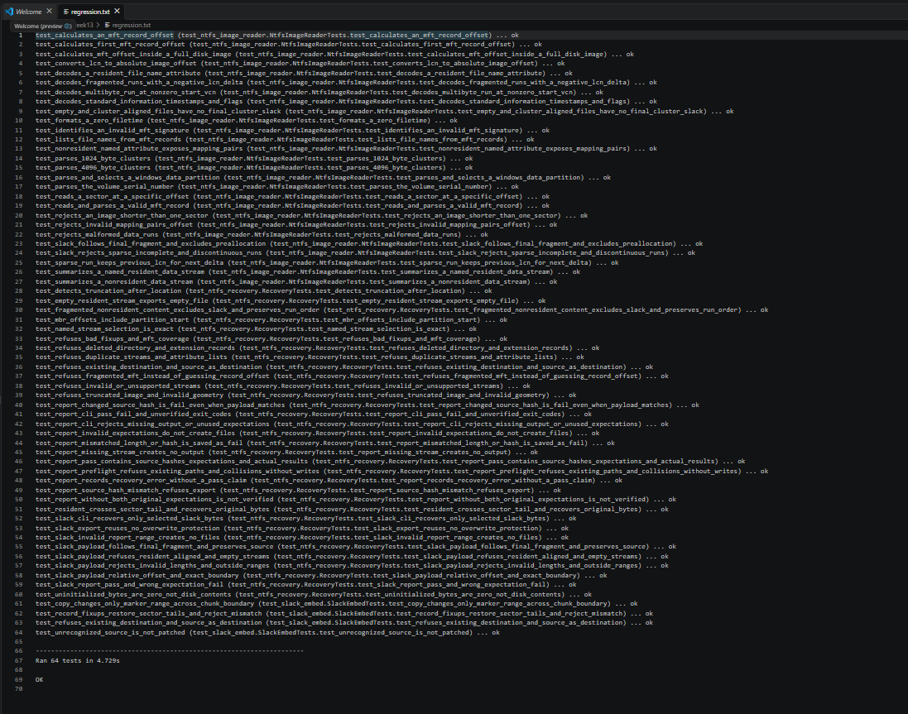
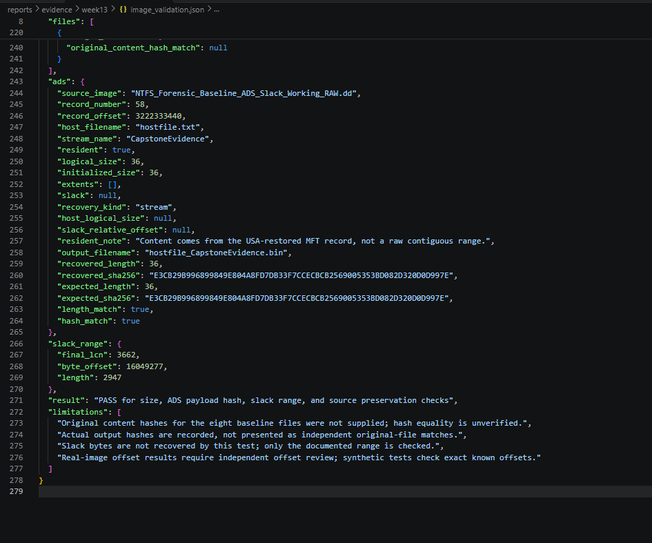
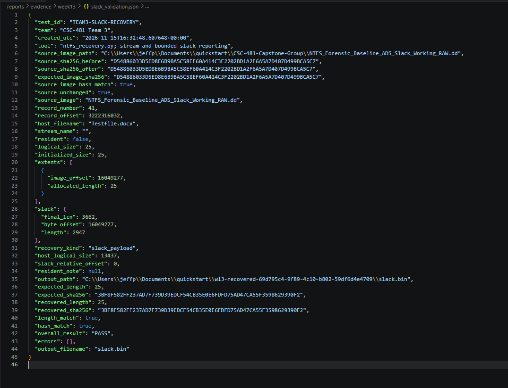

# Week 13 Team Progress Report

**Later follow-up, November 25:** Jeff confirmed original/recovered SHA-256 matches for all eight baseline files. See the [dated comparison](../docs/baseline_hash_verification.md). References below to missing original hashes describe the status during this report period.

**Reporting period:** November 9–15, 2026

**Team:** Capstone Project Team 3

**Status:** Complete — Week 13 testing and evidence documented

## Progress against the plan

Milestone 7 is in progress. This week focused on organizing forensic evidence
and running parser and recovery checks. Finalizing the evidence log and
technical report, completing regression testing, and updating code
documentation remain scheduled for November 16–22.

## Completed work

- **Jeff:** Prepared the November 15 validation record using assisted test
  runs on the Week 13 branch. Recorded successful checks and the remaining
  verification gap. No parser changes were needed for these runs.
- **Lucas:** Added the forensic evidence catalog, including a hash register,
  screenshot index, and payload hexdumps. Published the Week 12 slack workflow
  write-up on November 15; it records Week 12 work, not a new Week 13 test.
- **Team:** Met November 9 to plan the week and November 15 from 11:00 to
  11:30 a.m. to finalize the week's work. Discussed Lucas's template-based
  slack write-up and the fields that still needed supporting evidence.

## November 15 test results

| Check | Method and acceptance criterion | Result |
|---|---|---|
| Automated regression | Run the existing unit suite. Parser, recovery, reporting, and safety checks must pass. | **PASS:** 64 tests in 4.729 seconds, no failures or skips. |
| Eight baseline files | Locate and recover each file from the working image. Names and recovered lengths must match the known-file manifest. | **PASS:** 8 of 8 names and lengths matched. |
| Baseline file content | Compare each recovered file hash against its independently recorded original hash. | **NOT VERIFIED:** Original file hashes are unavailable. Matching lengths are not proof of matching content. |
| ADS payload | Recover the named ADS from record 58. Length and SHA-256 must match the original manifest. | **PASS:** 36 bytes and matching original SHA-256. |
| Slack location | Calculate the final-cluster slack range for record 41 and compare with the manifest. | **PASS:** 2,947 bytes starting at offset 16,049,277. |
| Slack payload | Export only the recorded 25-byte range and compare the recovered SHA-256 with the original manifest. | **PASS:** 25 bytes and matching original SHA-256. |
| Source preservation | Compare the working image hash with its expected hash and compare before/after hashes. | **PASS:** Working image hash matched and remained unchanged. |

### Methods and evidence

The November 15 runs used the existing unittest suite, the controlled-image
validation runner, and the read-only recovery utility with record 41 and
`--slack-length 25`. The validation runner retains its original
`W10-RECOVERY-SUPPORT` test ID; the timestamp in its JSON identifies the
fresh run. Recovered binaries and raw disk images are not included.

The source was the controlled `NTFS_Forensic_Baseline_ADS_Slack_Working_RAW.dd`
image. The original acceptance values come from the [known-file manifest](../docs/week6_known_file_manifest.md),
[ADS payload manifest](../docs/week7_ads_payload_manifest.md), and
[slack payload manifest](evidence/week8/w8_slack_payload_manifest.json).

- [November 15 regression log](evidence/week13/regression.txt)
- [November 15 baseline, ADS, and slack-range results](evidence/week13/image_validation.json)
- [November 15 slack payload and source-hash results](evidence/week13/slack_validation.json)
- [Forensic evidence catalog](FORENSIC_EVIDENCE_CATALOG.md)

### November 15 verification screenshots

These screenshots display the saved results of the November 15 runs.

## Lessons and remaining checks

Treat identification, byte-count checks, and hash verification as separate
claims. Both known payloads can be verified because their original hashes
were recorded independently. The eight baseline-file content checks remain
open: obtain original hashes and compare them before claiming exact matches.
No unexpected test failures were observed in the checks recorded above.

## Team records

- [November 9 planning minutes](../meeting_minutes/2026-11-09.md)
- [Jeff's journal](../weekly_journals/2026-11-15_jeff_perez.md)
- [Lucas's journal](../weekly_journals/2026-11-15_lucas_curtis.md)
